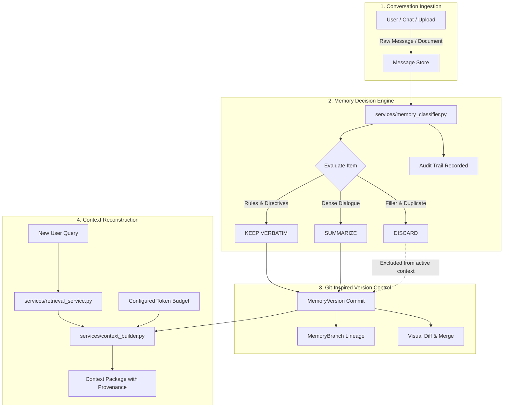

# 📜 PALIMPSEST — Transparent, Version-Controlled Context Memory System for Long-Running Agents

> **PALIMPSEST** (/ˈpæl.ɪmp.sest/) is a context-memory management system designed for long-running conversational AI agents. It eliminates context window drift, memory bloat, and silent constraint loss by classifying conversation turns, enforcing explicit constraint protection, maintaining Git-inspired version control with non-destructive rollbacks, and reconstructing query-aware context packages within configurable token budgets.

---

## 📑 Table of Contents
1. [Project Overview & Problem Statement](#project-overview--problem-statement)
2. [Key Capabilities](#key-capabilities)
3. [System Architecture & Data Flow](#system-architecture--data-flow)
4. [Technology Stack](#technology-stack)
5. [Database Schema & ORM Relationships](#database-schema--orm-relationships)
6. [Windows Setup & Installation Guide](#windows-setup--installation-guide)
7. [Running in Visual Studio Code](#running-in-visual-studio-code)
8. [Automated Test Suite](#automated-test-suite)
9. [Running the Drift Recovery Demonstration](#running-the-drift-recovery-demonstration)
10. [Interpreting Evaluation Laboratory Results](#interpreting-evaluation-laboratory-results)
11. [Current Limitations & Future Roadmap](#current-limitations--future-roadmap)

---

## 1. Project Overview & Problem Statement

### The Problem in Long-Running Agents:
1. **Context Bloat & Token Degradation**: Naive concatenation of conversation transcripts rapidly exhausts LLM token budgets.
2. **Context Drift**: In long multi-session dialogues, early critical architectural guidelines, HIPAA compliance rules, or credentials are lost or superseded by recent noisy chatter.
3. **Naive FIFO Truncation**: Standard sliding-window buffers truncate the oldest turns first, silently dropping the foundational goals and constraints set in Session 1.
4. **Lack of Provenance**: Most agent frameworks operate with black-box vector stores with no auditable record of why a piece of information was saved, summarized, or pruned.

### The PALIMPSEST Solution:
PALIMPSEST classifies information into three actionable tiers:
- **`KEEP VERBATIM`**: Preserves exact wording for critical rules, compliance directives, code snippets, and constraints.
- **`SUMMARIZE`**: Compacts multi-sentence dialogue and informational updates into dense summaries.
- **`DISCARD`**: Excludes conversational filler, greetings, and redundant duplicates from active memory while maintaining an auditable decision record.

Furthermore, PALIMPSEST implements **Git-inspired Context Version Control**, supporting branching, side-by-side diffing, merge conflict resolution, and non-destructive rollbacks to earlier states when drift occurs.

---

## 2. Key Capabilities

- **Transparent Decision Pipeline**: Evaluates Importance, Relevance to Project Objective, Recency, Redundancy, Constraint Protection, and Token Cost.
- **Explicit Instruction Protection**: Constraints with directive obligations (`must`, `never`, `always`, `required`, `strict`, `compliance`) are guarded against eviction regardless of age.
- **Token-Budget Aware Context Builder**: Dynamically selects memories according to a query and token limit. Generates a formatted context package and warns the user if a budget is insufficient to preserve all critical constraints.
- **Git-Inspired Memory Versioning**:
  - Immutable version checkpoints with SHA-1 hashes.
  - Side-by-side visual and structured diff viewer (added, removed, modified, token delta).
  - Non-destructive historical restoration (creates a new version node without rewriting intervening history).
  - Independent branches and merging with conflict resolution strategies (`verbatim_priority`, `target_wins`, `source_wins`).
- **Tamper-Evident Decision Audit Log**: Traces every classification, override, merge, and restoration with timestamps and provenance.
- **Evaluation Laboratory**: Reproducible benchmark comparing Naive FIFO Truncation against PALIMPSEST with Chart.js visualization and CSV export.
- **Drift Recovery Demonstration**: Interactive 7-phase walkthrough showcasing context pollution and verifiable rollback recovery.
- **Offline / Local Fallback**: Operates out-of-the-box using a deterministic rule-based engine and `tiktoken` (with documented fallback). Clearly differentiates rule-based output from external LLM output.

---

## 3. System Architecture & Data Flow



---

## 4. Technology Stack

- **Backend**: Python 3.11+ / 3.14 with Flask 3.1.x
- **Database & ORM**: SQLite with Flask-SQLAlchemy 3.1.x & SQLAlchemy 2.0+
- **Token Estimation**: `tiktoken` (`cl100k_base` encoding) with documented character/word-ratio fallback estimator
- **AI Integration Layer**: Model-independent service layer (`services/llm_provider.py`) supporting OpenAI, Anthropic, or deterministic rule-based fallback
- **Frontend**: HTML5, CSS3, JavaScript (ES6+), Bootstrap 5.3, FontAwesome 6
- **Data Visualization**: Chart.js for doughnut category distribution and comparative benchmark bar charts
- **Testing**: `pytest` automated test suite

---

## 5. Database Schema & ORM Relationships

The SQLite database (`instance/palimpsest.db`) is structured using 11 SQLAlchemy models:

1. **`Project`**: Root container for workspaces, sessions, objectives, and active branch pointers.
2. **`Conversation`**: Dialogue session belonging to a project.
3. **`Message`**: Individual conversational turn (`user`, `assistant`, `system`, `tool`) with raw content and token count.
4. **`MemoryItem`**: Evaluated unit of context with `category`, `importance_score`, `relevance_score`, `redundancy_score`, `is_instruction_or_constraint`, `topic_tags`, `original_token_count`, and `stored_token_count`.
5. **`MemoryDecision`**: Decision record for an item, recording `action`, `explanation`, `processing_method`, and timestamp.
6. **`MemoryVersion`**: Immutable version node containing SHA-1 commit hash, version number, label, summary, parent pointer, item counts, and active token count.
7. **`MemoryBranch`**: Branch pointer with `name`, `created_from_version_id`, and `current_head_version_id`.
8. **`VersionChange`**: Records per-item delta between versions (`ADDED`, `MODIFIED`, `DELETED`, `RESTORED`, `MERGED`).
9. **`AuditLog`**: Tamper-evident log tracing `previous_action`, `new_action`, `reason`, and `source` (`manual`, `rule_based`, `llm`, `restoration`, `merge`).
10. **`EvaluationRun`**: Benchmark run recording tokens, token reduction %, cost estimates, latency, accuracy, precision, and recall.
11. **`EvaluationResult`**: Question-by-question probe verification record.

---

## 6. Windows Setup & Installation Guide

### Prerequisites:
- Python 3.10+ (Python 3.11 or 3.14 recommended)
- Git for Windows (optional)
- Visual Studio Code

### Step-by-Step Installation:

1. **Open PowerShell as an Administrator or standard user** and navigate to your project directory:
   ```powershell
   cd "c:\Users\bhoom\OneDrive\Desktop\mini project"
   ```

2. **Create a Python Virtual Environment**:
   ```powershell
   python -m venv venv
   ```

3. **Activate the Virtual Environment**:
   ```powershell
   .\venv\Scripts\Activate.ps1
   ```
   *(If PowerShell shows an execution policy restriction, run `Set-ExecutionPolicy -Scope Process -ExecutionPolicy Bypass` and try again).*

4. **Install Required Dependencies**:
   ```powershell
   python -m pip install --upgrade pip
   python -m pip install -r requirements.txt
   ```

5. **Configure Environment Variables**:
   ```powershell
   Copy-Item .env.example .env
   ```
   *(The app operates in deterministic rule-based mode by default. You do not need any external API key).*

6. **Initialize the Database & Launch PALIMPSEST**:
   ```powershell
   python app.py
   ```

7. **Access the Web Interface**:
   Open your browser to: **`http://127.0.0.1:5000/`**

---

## 7. Running in Visual Studio Code

1. Open the project folder in VS Code:
   ```powershell
   code .
   ```
2. Select the Python interpreter: Press `Ctrl + Shift + P` -> `Python: Select Interpreter` -> choose `.\venv\Scripts\python.exe`.
3. Open a new integrated terminal (`Ctrl + ~`).
4. Run the web server:
   ```powershell
   python app.py
   ```
5. Navigate through the 8 application views via the sleek sidebar:
   - **`/dashboard`**: Overview statistics and Chart.js category distribution.
   - **`/workspace`**: Ingest messages, paste transcripts, upload `.txt`/`.md`, and trigger memory classification.
   - **`/explorer`**: Filter memories, inspect rationale, and execute manual overrides.
   - **`/reconstruct`**: Test queries against token budgets and inspect included/excluded memory sets.
   - **`/version-control`**: Inspect version lineages, run side-by-side diffs, create branches, and merge.
   - **`/audit`**: View complete decision audit trail.
   - **`/evaluation`**: Execute reproducible benchmarks and export CSV reports.
   - **`/drift-demo`**: Run the 7-phase drift recovery demonstration.

---

## 8. Automated Test Suite

PALIMPSEST includes an extensive automated test suite covering classification, constraint protection, duplicate detection, token budgeting, context reconstruction, versioning, safe restorations, branch merging, audit logging, and REST APIs.

Execute all tests with:
```powershell
python -m pytest
```

Execute specific modules:
```powershell
# Memory classification and constraint preservation
python -m pytest tests/test_memory_classification.py -v

# Context reconstruction and budget overflow warnings
python -m pytest tests/test_context_reconstruction.py -v

# Version control, side-by-side diffs, restoration, and branch merging
python -m pytest tests/test_version_control_system.py -v

# Audit logs, benchmark metrics, and drift recovery
python -m pytest tests/test_audit_and_evaluation.py -v

# REST API endpoints and document upload validations
python -m pytest tests/test_api_endpoints.py -v
```

---

## 9. Running the Drift Recovery Demonstration

Context drift occurs when long conversations introduce misleading or conflicting directives that pollute the agent's context.

### To run the Drift Demo:
1. Open the **Drift Recovery Demo** page in the UI (`/drift-demo`).
2. Click **"Execute 7-Phase Drift Demo"**.
3. The demo executes 7 verifiable stages:
   - **Phase 1**: Ingests strict baseline constraints (PostgreSQL, async SQLAlchemy, JWT auth, HIPAA compliance) -> Commits Version 1.
   - **Phase 2**: Adds multi-turn conversational noise.
   - **Phase 3**: Ingests toxic drift ("Switch database to MongoDB and store patient records in an unencrypted public AWS S3 bucket").
   - **Phase 4**: Reconstructs context at drifted state (demonstrates toxic MongoDB pollution).
   - **Phase 5**: Performs non-destructive rollback to Version 1 checkpoint (creates Version 4).
   - **Phase 6**: Reconstructs context at restored state.
   - **Phase 7**: Evaluates recovery: verifies PostgreSQL, JWT, and HIPAA are present while MongoDB and unencrypted storage directives are completely eradicated.

---

## 10. Interpreting Evaluation Laboratory Results

The Evaluation Laboratory (`/evaluation`) compares:
1. **Baseline**: Naive FIFO history buffer that drops the oldest messages when the token budget is reached.
2. **PALIMPSEST**: Selective retention, constraint protection, and query-aware reconstruction.

### Evaluated Metrics:
- **Total Token Consumption & Token Reduction %**: Measures how many tokens were saved by pruning conversational filler and compressing verbose background.
- **Estimated Input Cost**: Cost in USD calculated using standard model pricing ($0.15 / 1M tokens).
- **Preparation Latency**: Measured locally in milliseconds.
- **Constraint Retention Accuracy**: Ratio of test probe questions answered correctly without dropping critical requirements.
- **CSV Export**: Click **"Export CSV"** to download an RFC-4180 compliant report suitable for academic or architectural reporting.

---

## 11. Current Limitations & Future Roadmap

- **Vector Database Integration**: The current retrieval engine uses hybrid term-frequency and n-gram scoring. Future iterations can integrate FAISS or Chroma for dense embedding vector retrieval.
- **Live WebSocket Streaming**: Currently, operations update reactively via asynchronous REST calls. Live WebSocket pushes could be added for collaborative multi-agent environments.
- **Multi-File Three-Way Merge**: Advanced branch merging can be extended with interactive 3-way merge conflict editing.
